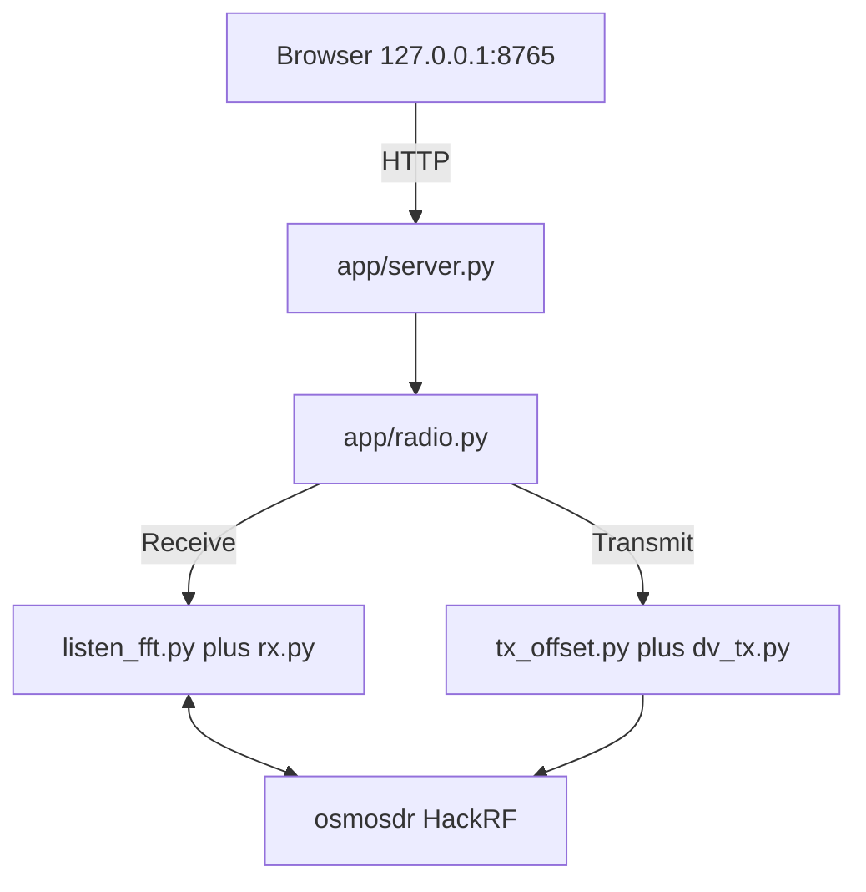
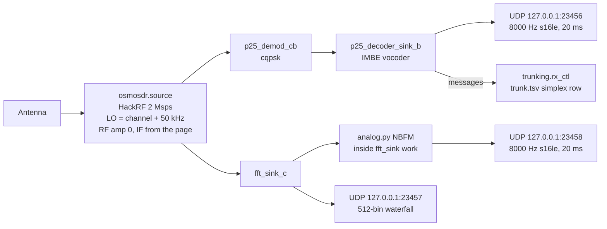
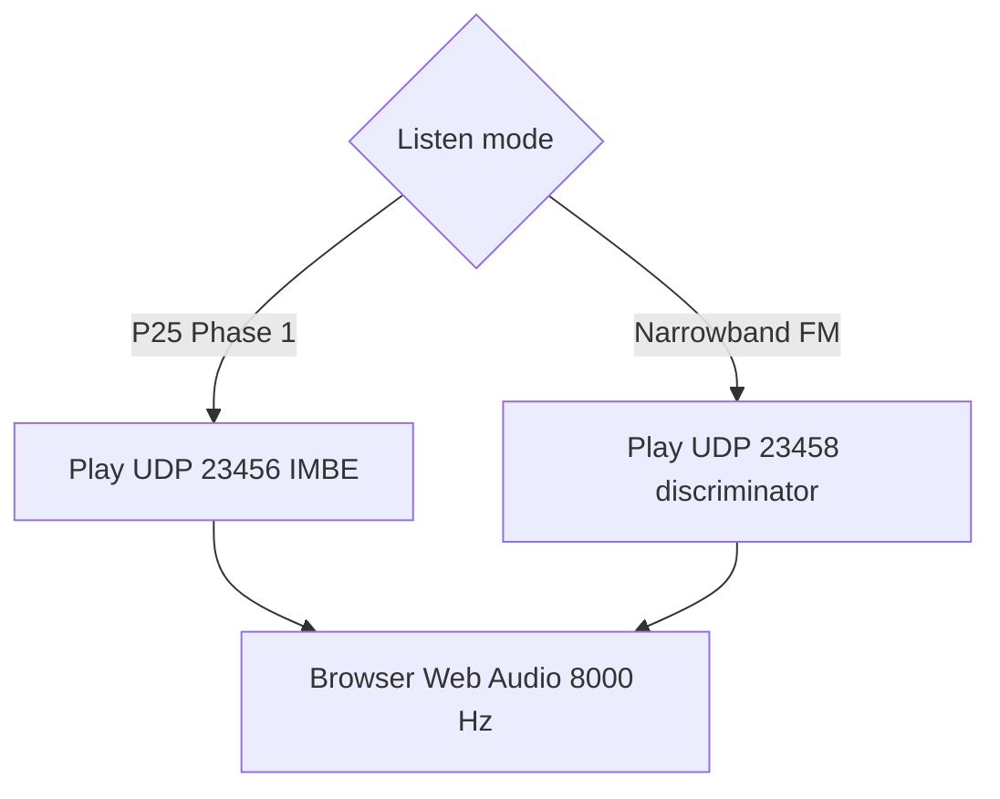
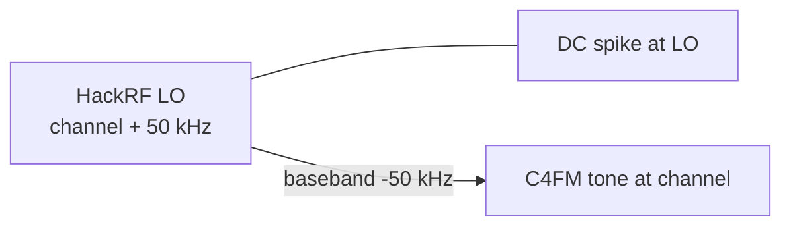
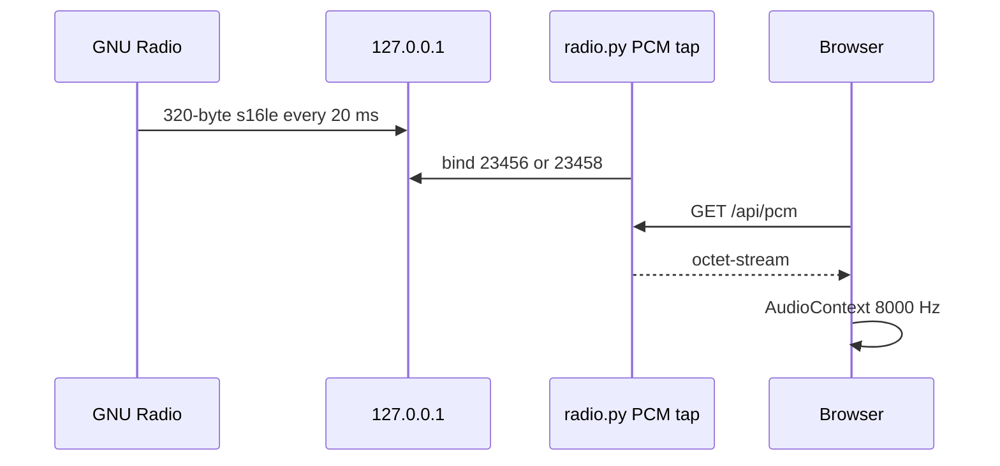

# GNU Radio graphs

This page is the GNU Radio inside jim-p25. The browser never talks to GNU Radio. `app/radio.py` starts two flowgraphs, never both: listen (`app/listen_fft.py` → boatbod `rx.py`) or transmit (`app/tx_offset.py` → `dv_tx.py`). Sample rate is 2 Msps. RF amplifier stays off.

Half duplex: one HackRF, one graph at a time. Stop kills the child.

## Listen graph

`rx.py` builds this graph. `listen_fft.py` starts it with `-P fft`, `-w` (UDP audio, no ALSA), `-o 50000`, `-S 2000000`, `--args hackrf`, demod `cqpsk`.

The FFT tap is `demod.connect_complex('src', fft_sink)`: the same 2 Msps IQ the demod sees, before symbol recovery.

### What each listen block does

| Block | What it does |
| --- | --- |
| **osmosdr.source** | Opens the HackRF. Center frequency is the typed channel plus 50 kHz, so the DC spike is not on the voice. PPM from the page. IF gain from Listen gain. RF gain 0. |
| **p25_demod_cb (cqpsk)** | Mixes the channel down by the 50 kHz offset, clock recovery, Costas loop. boatbod uses this demod for Phase 1 C4FM. Output is dibits. |
| **p25_decoder_sink_b** | P25 Phase 1 framer. NAC must match, or the page NAC is F7E. Clear IMBE (`do_imbe`) becomes 8000 Hz PCM. Encrypted frames stay silent. `-w` sends PCM as UDP, 320 bytes per 20 ms. |
| **trunking.rx_ctl** | Reads `local/trunk.tsv`. One conventional row, modulation `cqpsk`. On simplex there are no TSBKs, so it prints control channel timeout. Voice on the tuned frequency still decodes. |
| **fft_sink_c** | GNU Radio consumes every IQ sample. A 512-bin FFT is published about 20 times a second for the waterfall. The center bin is the typed frequency after `listen_fft.py` rolls the row. |
| **analog.py NBFM** | Runs on **every** IQ sample in `fft_sink_c.work`, not on the 20 Hz FFT slice. Mixes +50 kHz to put the channel at DC, boxcar-decimates to 16 kHz (about a 12.5 kHz channel), FM discriminator scaled to ±2.5 kHz, 750 µs de-emphasis, 300 Hz high-pass, 8 kHz PCM. SQL 0 is open. Closed SQL sends silence so the stream stays in time. |

Listen mode on the page is one path:

`radio.py` polls `/api/pcm` from the port that matches the dropdown. The waterfall and AM/FM classifier still run from the FFT IQ in both modes.

## Transmit graph

Symbols are built as files first (not GNU Radio). GNU Radio starts at `dv_tx.py`. `tx_offset.py` patches the FM modulator and moves the HackRF LO up 50 kHz before `dv_tx.py` runs.

```mermaid
flowchart LR
    page[NAC, TG, source]
    craft[p25craft.py<br/>1011 Hz IMBE, algid 80]
    packed[local/p25.out]
    unpack[unpack.py]
    dibits[local/p25.dat<br/>dibits 0-3]
    src[file_source char<br/>repeat]
    c4fm[p25_mod_bf<br/>C4FM pulse shape]
    amp[multiply_const]
    interp[rational_resampler<br/>to 2 Msps]
    fm[ShiftedFM<br/>frequency_modulator_fc<br/>plus rotator -50 kHz]
    sink[osmosdr.sink<br/>HackRF 2 Msps<br/>LO = channel + 50 kHz<br/>RF 0, IF from the page]

    page --> craft --> packed --> unpack --> dibits --> src --> c4fm --> amp --> interp --> fm --> sink
```

### What each transmit block does

| Block | What it does |
| --- | --- |
| **p25craft.py** | Not GNU Radio. Writes a clear group call: NAC, talkgroup, source from the page, LCO 0, algid `0x80`, TIA 1011 Hz IMBE vector. |
| **unpack.py** | Dibits 0–3 for the C4FM mapper. |
| **file_source** | Reads `p25.dat` as bytes, repeats (`-r`) until Stop. |
| **p25_mod_bf** | C4FM pulse shaping. Dibit map is the usual ±1/3, ±1 levels into a real baseband waveform at the modulator rate. |
| **multiply_const** | OP25 `output_gains['p25']`. |
| **rational_resampler** | Upsamples to the HackRF rate, 2 Msps. |
| **frequency_modulator_fc** | Turns that real waveform into complex FM at baseband DC. Deviation is OP25’s P25 FM sensitivity. |
| **rotator_cc** | `app/tx_offset.py` `ShiftedFM`. Phase step is −2π × 50 kHz / 2 Msps, so the C4FM carrier sits 50 kHz below DC. |
| **osmosdr.sink** | HackRF. `tx_offset.py` sets `-Q` to channel + 50 kHz. RF = LO + baseband = (channel + 50 kHz) + (−50 kHz) = the typed frequency. DC spike stays 50 kHz above the tone. RF gain 0. IF gain from Transmit IF gain. `buffers=64`. |

On the air:

GNU Radio takes a few seconds to start. The page latches Transmit until Stop. Underruns print `U` (one USB buffer of zeros).

## Audio into the browser

Neither graph has an ALSA sink. WSL has no card.

P25 vocoder uses 23456. NBFM uses 23458. The first Receive click starts the AudioContext (browser rule).
