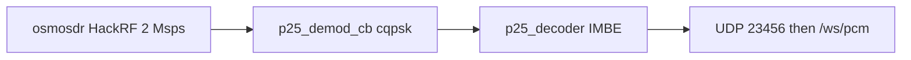
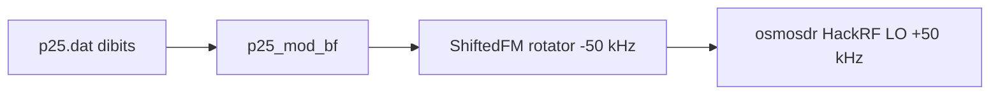
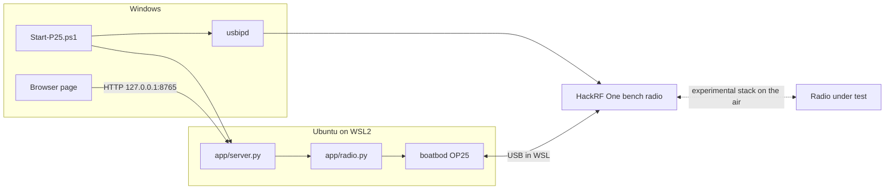
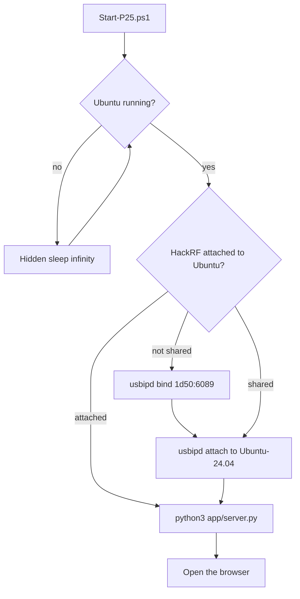
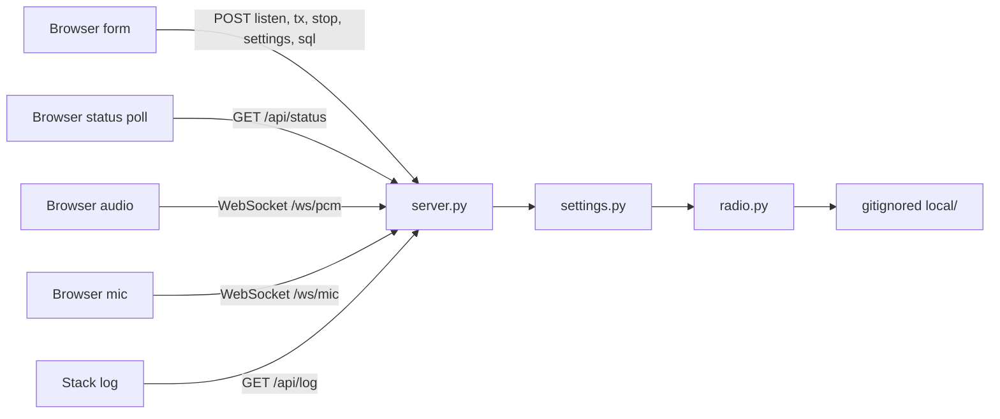
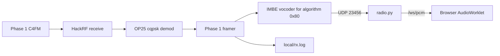
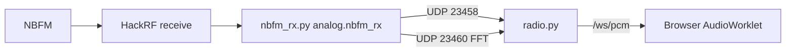
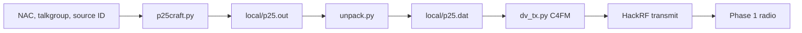

# jim-p25

A HackRF One bench radio you test experimental stacks against.

The bench is the board, a small page, and half-duplex GNU Radio. Stacks plug in: P25 Phase 1 conventional simplex and narrowband FM today, NXDN next. Put a stock radio on the other end of the bench when a stack needs a known-good unmute check.

The page runs in Ubuntu on WSL2 and opens in the Windows browser. WSL has no ALSA card. Receive and microphone audio use UDP plus a WebSocket into the tab, not `audio.sink`. Receive latches listen. Transmit latches the 1011 Hz P25 test tone or analog NBFM from the browser mic. Stop turns either one off.

## The page

These pictures are the empty form. A frequency you type is saved on this computer under `local/`, which is not in git.


Receive, Transmit, and Stop sit under the channel fields. Listen mode is P25 or FM. FM channel is Wide 25 kHz or Narrow 12.5 kHz. Accept any NAC ($F7E) greys out the NAC box. Squelch is live on FM. The status card is next, then the waterfall, then the stack log.


The Help section is the operator reference: NAC, $F7E, talkgroup, source ID, PPM, both gains, analog vs P25 audio, the 1011 Hz test tone, and a radio that lights and stays quiet.

## Goals

Build a bench radio on a HackRF One, then hang experimental stacks on it and test them.

The bench:

- One HackRF One, half duplex, RF amplifier off. Listen or transmit, never both. 2 Msps. Tuner 50 kHz above the typed channel so the DC spike is off the voice.
- A small page: frequency, stack fields (NAC, talkgroup, source ID), clock correction (PPM), listen gain, transmit IF gain, Listen mode, Receive / Transmit / Stop. Each of Receive and Transmit latches until Stop.
- Browser audio over UDP plus WebSocket `/ws/pcm`. WSL has no ALSA card.
- A 2 MHz listening waterfall centered on the channel. White line is the VFO. Yellow band is the stack’s channel width. Red line is the HackRF local oscillator.
- A stack log under the waterfall. Companion `.grc` graphs in [`grc/`](grc/README.md) so the same bench can move to a Raspberry Pi later.

Experimental stacks on that bench:

- **P25 Phase 1 conventional simplex** (live). One C4FM channel. Clear IMBE, algorithm ID `0x80`. Transmit is the 1011 Hz test tone with the page NAC, talkgroup, and source ID. Listen is boatbod OP25 cqpsk. OP25’s live microphone coder hardcodes a NAC, so this stack does not use the mic.
- **Narrowband FM** (live). C++ `analog.nbfm_rx` / `analog.nbfm_tx`, ±2.5 kHz Narrow or ±5 kHz Wide, UDP into the same browser audio. Microphone transmit is this stack.
- **NXDN conventional** (next). Vocoder layer we invent, 4FSK and frames we own. Public AMBE+2 is an optional wrap. See [ROADMAP.md](ROADMAP.md).
- Later stacks (DMR, Fusion) after NXDN receive works. This OP25 build already lists them in `dv_tx.py`.

This bench stays clear-voice and conventional. No Phase 2 TDMA, trunking, scanning, encryption keys, inhibit messages, or firmware flashing.

Use a frequency you are allowed to transmit on. Keep the radios close together, or put a dummy load on the HackRF.

## Roadmap

See [ROADMAP.md](ROADMAP.md). The HackRF bench stays put. New work is another experimental stack on it. The vocoder is a layer we invent (silence, our test tone, optional public AMBE+2 wrap). NXDN framing and 4FSK sit around that layer.

## Progress

Listen works. A Phase 1 clear call on the tuned frequency plays in the browser.

Transmit keys the HackRF and the symbol file is real P25. On the last transmission, every frame carried NAC `0x293` (659 decimal): one header, 70 voice frames that carry the talkgroup, and 70 voice frames that carry algorithm `0x80`. The same encoder’s output has decoded as a group call, talkgroup 1, source 1, with zero voice-frame errors. The link-control opcode is 0 (group call), and the manufacturer ID is 0.

A Motorola conventional radio has shown a receive indication and stayed silent when the page used Motorola’s usual defaults: NAC `293`, talkgroup 1, source ID 1, encryption off. Those values are present in the frames. The next check is a second radio on the same channel. The page waterfall shows the 2 MHz around the tuned frequency while listening, with the HackRF DC spike 50 kHz above the center line.

`local/rx.log` prints `control channel timeout` on a simplex channel. OP25’s receiver is built around a trunk tracker, and a simplex radio does not send trunking control messages. Voice frames on the tuned frequency still decode.

## Process

From this folder in PowerShell:

```powershell
.\Start-P25.ps1 -Status
.\Start-P25.ps1
.\Start-P25.ps1 -Restart
.\Start-P25.ps1 -Stop
```

`-Status` prints whether Ubuntu, the HackRF, and the page are up. With no switch, the script starts Ubuntu if it is stopped, attaches the HackRF, and opens `http://127.0.0.1:8765/`. If the page is already up, it only opens the browser. `-Restart` stops the page and starts it again. `-Stop` stops the page.

On the page, enter the frequency in MHz and the NAC in hex (`293` and `0x293` are the same). An empty talkgroup or source ID becomes 1. PPM is the HackRF clock correction in parts per million. Leave it at 0 unless the radio is slightly off the channel. At 446 MHz, 1 PPM is about 446 Hz.

Receive and Transmit each latch on. A second click does not turn them off, so the few seconds GNU Radio spends starting does not get cancelled. Stop turns either one off. Listen mode is P25 or FM. The browser plays 8 kHz PCM over WebSocket `/ws/pcm`. Check Accept any NAC ($F7E) to grey out the NAC box.

The page stores frequency, NAC, talkgroup, source ID, PPM, both gains, listen mode, FM width, squelch, and transmit source in `local/settings.json` as you type, and fills them back in when you open it. Listen and transmit also write the channel files under `local/`. That folder is gitignored, along with logs. Nothing in git has a channel filled in.

This stack does not run on Windows itself. On this machine it lives in WSL distro `Ubuntu-24.04`, running as root:

- GNU Radio 3.10, `gr-osmosdr`, and `libhackrf` from Ubuntu. The working HackRF tools are the Ubuntu `hackrf` package, not a newer source-only release.
- [boatbod/op25](https://github.com/boatbod/op25) installed under `/root/op25` with `./install.sh -f`, after source packages are enabled in `/etc/apt/sources.list.d/ubuntu.sources`.
- HackRF USB shared with usbipd. `1d50:6089` is the public HackRF product id. The board serial is not stored in this repo. The existing firmware was left as it is. WinUSB on the Windows side was already in place, so Zadig was not used.

The launcher keeps Ubuntu running with a hidden `sleep infinity` before it attaches USB. usbipd cannot attach the HackRF while the distro is stopped. While the HackRF is attached to Ubuntu, Windows programs cannot open it.

## GNU Radio

The receive and transmit GNU Radio graphs, and what each block does, are in [GNU-RADIO.md](GNU-RADIO.md). Companion `.grc` sources for the NBFM pair (later Raspberry Pi work) are in [grc/](grc/README.md).



P25 listen: HackRF → cqpsk demod → IMBE → UDP 23456 → WebSocket `/ws/pcm`. FM listen is a separate C++ graph in `app/nbfm_rx.py` (`analog.nbfm_rx` → UDP 23458, `fft_vcc` → UDP 23460). Python `work()` taps crashed this WSL mix and overflowed the HackRF.



Transmit: C4FM at baseband, rotated down 50 kHz, HackRF tuned 50 kHz high, so the tone stays on the typed frequency.

## Components



### Launcher

`Start-P25.ps1` is the Windows entry point.



Stopping the page also stops a leftover `rx.py` or `dv_tx.py`. Those children run in their own session, so closing only the page would leave the HackRF busy.

### Page

`app/server.py` serves `app/index.html` on `127.0.0.1:8765` and calls `app/radio.py`. `app/settings.py` checks the form: frequency 1–6000 MHz, a 12-bit NAC, talkgroup up to 65535, source ID up to 16777215, PPM from −200 to 200. Listen and transmit IF gains snap to 0, 8, 16, 24, 32, or 40. RF gain is always 0. The typed fields, including a half-finished frequency, are kept in `local/settings.json`. Listen still requires a valid frequency.



### Listen

Listen mode P25 writes one conventional row to `local/trunk.tsv` and starts `app/listen_fft.py`, which runs OP25 `rx.py` with the working directory set to the OP25 apps folder. The demod is `cqpsk`, which boatbod OP25 uses for Phase 1 C4FM as well as CQPSK. The HackRF local oscillator is 50 kHz above the channel, so its DC spike is not on the tuned frequency. The sample rate is 2 Msps. The page draws that spectrum as a waterfall: the center line is the channel, and the red line is the DC spike. The vocoder is on. Phase 2 flags are not passed.

Decoded P25 voice leaves OP25 as UDP on `127.0.0.1:23456`: 8000 Hz, 16-bit mono, 320 bytes per 20 ms. FM listen starts `app/nbfm_rx.py` instead: C++ `analog.nbfm_rx` to UDP `127.0.0.1:23458`, C++ FFT bins to UDP `127.0.0.1:23460`. The page plays whichever tap matches the dropdown over WebSocket `/ws/pcm`. WSL has no ALSA card, so `audio.sink` is never used. Python GNU Radio `work()` taps crashed this mix; FM stays on C++ blocks. `rx.py` must not be run with Python’s unbuffered flag. Its startup calls `detach()` twice, and that crashes when stderr is already a raw file.



FM:



Encrypted frames stay silent. A NAC of `F7E` or `F7F` on the page accepts any received NAC. Any other NAC must match.

### Transmit

Transmit source Tone builds a symbol file and starts `dv_tx.py`. The tone repeats until Stop. Transmit source Microphone starts `app/nbfm_tx.py` with analog NBFM from WebSocket `/ws/mic`. Stop returns the HackRF to idle. There is no time limit.

`p25craft.py` writes the clear group call: NAC, talkgroup, and source ID from the page, destination unused for a group call, algorithm `0x80`, key ID 0, manufacturer ID 0, link-control opcode 0. The voice codeword is the TIA 1011 Hz test vector. `unpack.py` turns that into dibits 0–3. `app/tx_offset.py` runs `dv_tx.py`, tunes the HackRF 50 kHz above the channel, and shifts the C4FM carrier back down so the DC spike is not on the tone. `dv_tx.py` modulates at 2 Msps, repeats until Stop, and sends the samples to the HackRF with extra USB buffers. The first moments can print `U`, which is one buffer of silence. The tone follows.



The dry check, used before the first on-air test, runs `dv_tx.py` to a float file and does not open the HackRF. A non-empty file only proves the modulator ran. It does not prove deviation or that a radio will unmute.

## Layout

```
GNU-RADIO.md      listen and transmit GNU Radio graphs
grc/              Companion .grc flowgraphs for NBFM, Pi-ready
ROADMAP.md        NXDN and public AMBE+2 decode
Start-P25.ps1     Windows launcher
app/server.py     localhost page, /ws/pcm and /ws/mic
app/index.html    the form, waterfall, stack log, help, and browser audio
app/listen_fft.py P25 listening spectrum and OP25 rx.py
app/nbfm_rx.py    FM listen: C++ nbfm_rx plus FFT, UDP no ALSA
app/nbfm_tx.py    analog NBFM from the browser mic
app/analog.py     leftover Python NBFM (not the live FM path)
app/moddetect.py  AM vs FM from IQ
app/tx_offset.py  transmit tuner 50 kHz above the channel
app/nxdn/         NXDN48 framer we own; AMBE+2 is a wrap, not in this tree
app/radio.py      listen and transmit processes
app/settings.py   form checks
local/            settings, channel files, and logs, not in git
```
