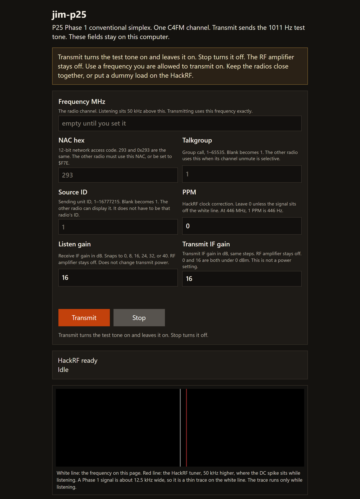
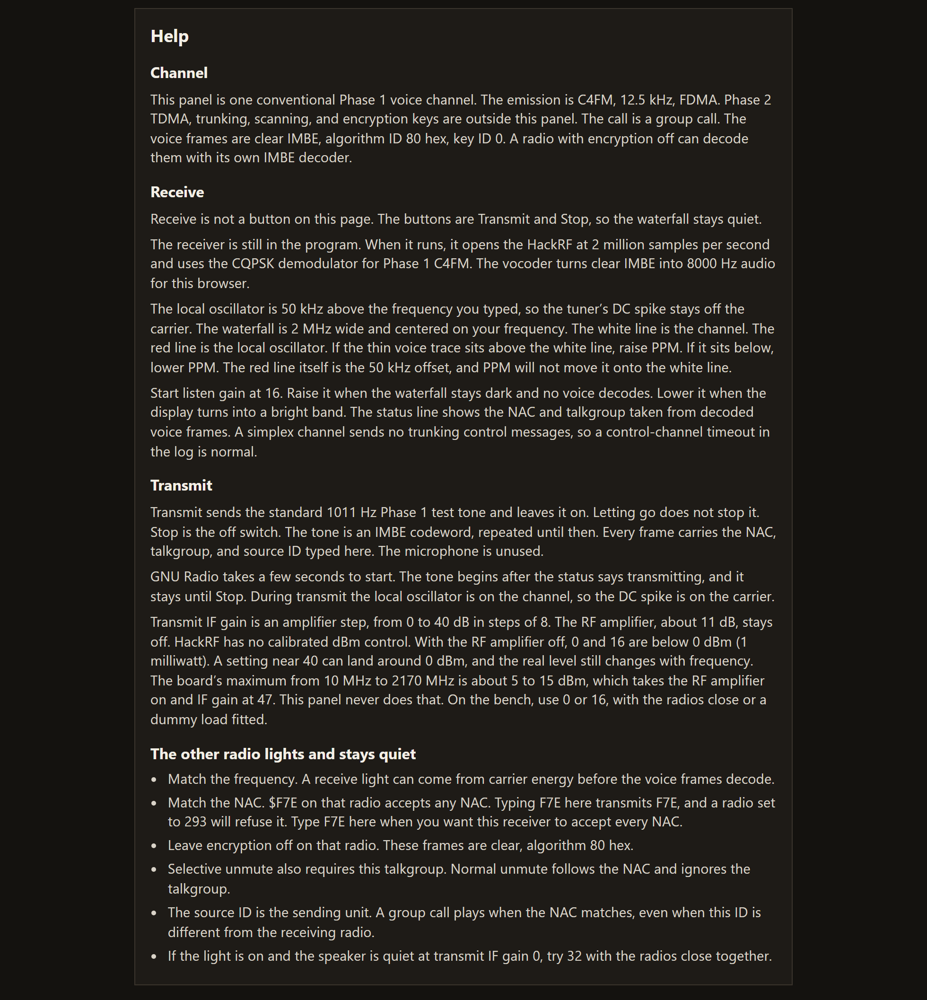
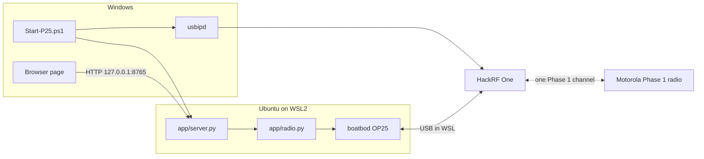
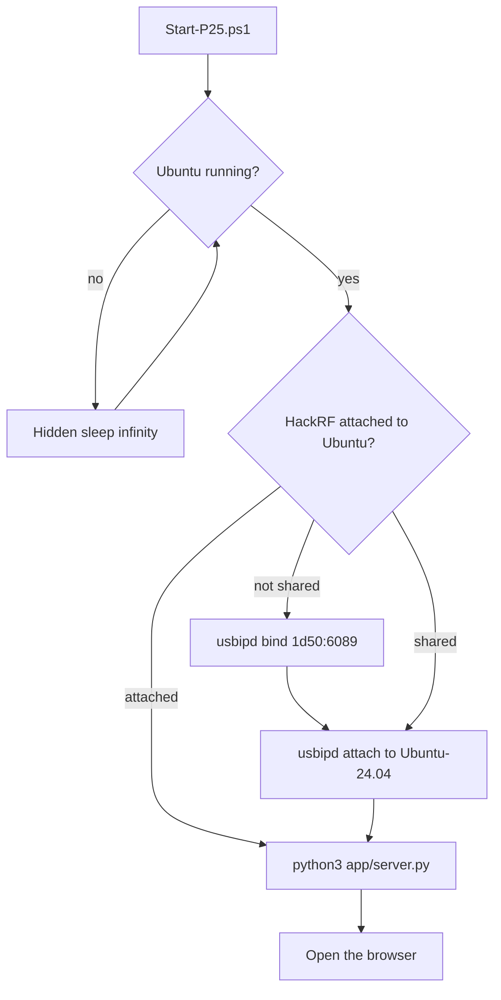
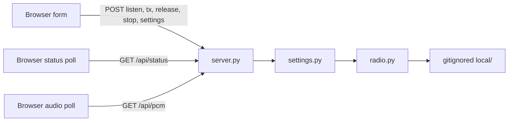
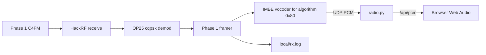
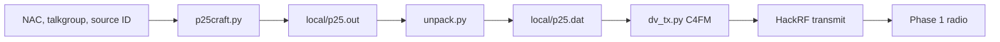

# jim-p25

P25 Phase 1 conventional simplex tester for a HackRF One and a Motorola radio you are allowed to test.

The page runs in Ubuntu on WSL2 and opens in the Windows browser. You set one frequency and the P25 network access code (NAC). Transmit latches the standard 1011 Hz Phase 1 test tone with that NAC, talkgroup, and source ID. Stop turns the tone off.

## The page

These pictures are the empty form. A frequency you type is saved on this computer under `local/`, which is not in git.



Transmit and Stop sit under the channel fields. The status card is next, then the waterfall. Receive is not a button on this page, so the waterfall stays quiet. The white line is the channel. The red line is the tuner, 50 kHz higher.



The Help section is the operator reference: NAC, talkgroup, source ID, PPM, both gains, the 1011 Hz test tone, and what to check when the other radio lights and stays quiet.

## Goals

In scope:

- One conventional Phase 1 channel. C4FM on transmit. The Phase 1 demod on listen.
- A small page: frequency, NAC, talkgroup, source ID, clock correction (PPM), listen gain, and transmit IF gain.
- Clear voice only. The algorithm ID is fixed at `0x80`. There is no key field.
- Push-to-talk audio is the 1011 Hz IMBE test tone, so the NAC and IDs on the page are the ones in the frames. OP25’s live microphone coder hardcodes a NAC, so this page does not use the mic.
- Half duplex. The HackRF listens or transmits, never both. The page buttons are Transmit and Stop. Transmit latches the test tone until Stop. RF gain stays at 0.
- A listening waterfall, 2 MHz wide, centered on the channel. The white line is the channel. The red line is the HackRF local oscillator, 50 kHz higher.

Out of scope:

- Phase 2 TDMA, trunking, and scanning.
- Encryption, decryption, and keys.
- Inhibit, radio-check, and other radio-disable messages.
- Firmware flashing.
- NXDN. This OP25 build can encode P25, DMR, D-Star, and Yaesu System Fusion. The page sends only the P25 test tone. There is no NXDN encoder in the build.

Use a frequency you are allowed to transmit on. Keep the radios close together, or put a dummy load on the HackRF.

## Progress

Listen works. A Phase 1 clear call on the tuned frequency plays in the browser.

Transmit keys the HackRF and the symbol file is real P25. On the last transmission, every frame carried NAC `0x293` (659 decimal): one header, 70 voice frames that carry the talkgroup, and 70 voice frames that carry algorithm `0x80`. The same encoder’s output has decoded as a group call, talkgroup 1, source 1, with zero voice-frame errors. The link-control opcode is 0 (group call), and the manufacturer ID is 0.

A Motorola conventional radio has shown a receive indication and stayed silent when the page used Motorola’s usual defaults: NAC `293`, talkgroup 1, source ID 1, encryption off. Those values are present in the frames. The next check is a second radio on the same channel. The page waterfall shows the 2 MHz around the tuned frequency while listening, with the HackRF DC spike 50 kHz above the center line.

`local/rx.log` prints `control channel timeout` on a simplex channel. OP25’s receiver is built around a trunk tracker, and a simplex radio does not send trunking control messages. Voice frames on the tuned frequency still decode.

## Process

From this folder in PowerShell:

```powershell
.\Start-P25.ps1 -Status
.\Start-P25.ps1
.\Start-P25.ps1 -Restart
.\Start-P25.ps1 -Stop
```

`-Status` prints whether Ubuntu, the HackRF, and the page are up. With no switch, the script starts Ubuntu if it is stopped, attaches the HackRF, and opens `http://127.0.0.1:8765/`. If the page is already up, it only opens the browser. `-Restart` stops the page and starts it again. `-Stop` stops the page.

On the page, enter the frequency in MHz and the NAC in hex (`293` and `0x293` are the same). An empty talkgroup or source ID becomes 1. PPM is the HackRF clock correction in parts per million. Leave it at 0 unless the radio is slightly off the channel. At 446 MHz, 1 PPM is about 446 Hz.

The buttons are Transmit and Stop. Transmit latches the test tone on, and letting go does not stop it. Stop turns it off. GNU Radio spends a few seconds starting.

The page stores frequency, NAC, talkgroup, source ID, PPM, and both gains in `local/settings.json` as you type, and fills them back in when you open it. Listen and transmit also write the channel files under `local/`. That folder is gitignored, along with logs. Nothing in git has a channel filled in.

This stack does not run on Windows itself. On this machine it lives in WSL distro `Ubuntu-24.04`, running as root:

- GNU Radio 3.10, `gr-osmosdr`, and `libhackrf` from Ubuntu. The working HackRF tools are the Ubuntu `hackrf` package, not a newer source-only release.
- [boatbod/op25](https://github.com/boatbod/op25) installed under `/root/op25` with `./install.sh -f`, after source packages are enabled in `/etc/apt/sources.list.d/ubuntu.sources`.
- HackRF USB shared with usbipd. `1d50:6089` is the public HackRF product id. The board serial is not stored in this repo. The existing firmware was left as it is. WinUSB on the Windows side was already in place, so Zadig was not used.

The launcher keeps Ubuntu running with a hidden `sleep infinity` before it attaches USB. usbipd cannot attach the HackRF while the distro is stopped. While the HackRF is attached to Ubuntu, Windows programs cannot open it.

## Components



### Launcher

`Start-P25.ps1` is the Windows entry point.



Stopping the page also stops a leftover `rx.py` or `dv_tx.py`. Those children run in their own session, so closing only the page would leave the HackRF busy.

### Page

`app/server.py` serves `app/index.html` on `127.0.0.1:8765` and calls `app/radio.py`. `app/settings.py` checks the form: frequency 1–6000 MHz, a 12-bit NAC, talkgroup up to 65535, source ID up to 16777215, PPM from −200 to 200. Listen and transmit IF gains snap to 0, 8, 16, 24, 32, or 40. RF gain is always 0. The typed fields, including a half-finished frequency, are kept in `local/settings.json`. Listen still requires a valid frequency.



### Listen

Listen writes one conventional row to `local/trunk.tsv` and starts `app/listen_fft.py`, which runs OP25 `rx.py` with the working directory set to the OP25 apps folder. The demod is `cqpsk`, which boatbod OP25 uses for Phase 1 C4FM as well as CQPSK. The HackRF local oscillator is 50 kHz above the channel, so its DC spike is not on the tuned frequency. The sample rate is 2 Msps. The page draws that spectrum as a waterfall: the center line is the channel, and the red line is the DC spike. The vocoder is on. Phase 2 flags are not passed.

Decoded voice leaves OP25 as UDP on `127.0.0.1:23456`: 8000 Hz, 16-bit mono, 320 bytes per 20 ms voice frame. The page keeps those frames and the browser plays them. WSL has no speaker, so the ALSA player is not started. `rx.py` must not be run with Python’s unbuffered flag. Its startup calls `detach()` twice, and that crashes when stderr is already a raw file.



Encrypted frames stay silent. A NAC of `F7E` or `F7F` on the page accepts any received NAC. Any other NAC must match.

### Transmit

Transmit builds a symbol file and starts `dv_tx.py`. The tone repeats until Stop. Stop returns the HackRF to idle. There is no time limit.

`p25craft.py` writes the clear group call: NAC, talkgroup, and source ID from the page, destination unused for a group call, algorithm `0x80`, key ID 0, manufacturer ID 0, link-control opcode 0. The voice codeword is the TIA 1011 Hz test vector. `unpack.py` turns that into dibits 0–3. `dv_tx.py` C4FM-modulates the file at 2 Msps, repeats it until Stop, and sends it to the HackRF with extra USB buffers. The first moments can print `U`, which is one buffer of silence. The tone follows.



The dry check, used before the first on-air test, runs `dv_tx.py` to a float file and does not open the HackRF. A non-empty file only proves the modulator ran. It does not prove deviation or that a radio will unmute.

## Layout

```
Start-P25.ps1     Windows launcher
app/server.py     localhost page
app/index.html    the form, waterfall, help, and browser audio
app/listen_fft.py listening spectrum, no gnuplot window
app/radio.py      listen and transmit processes
app/settings.py   form checks
local/            settings, channel files, and logs, not in git
```
