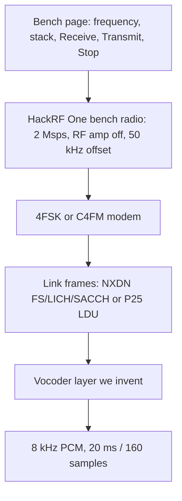
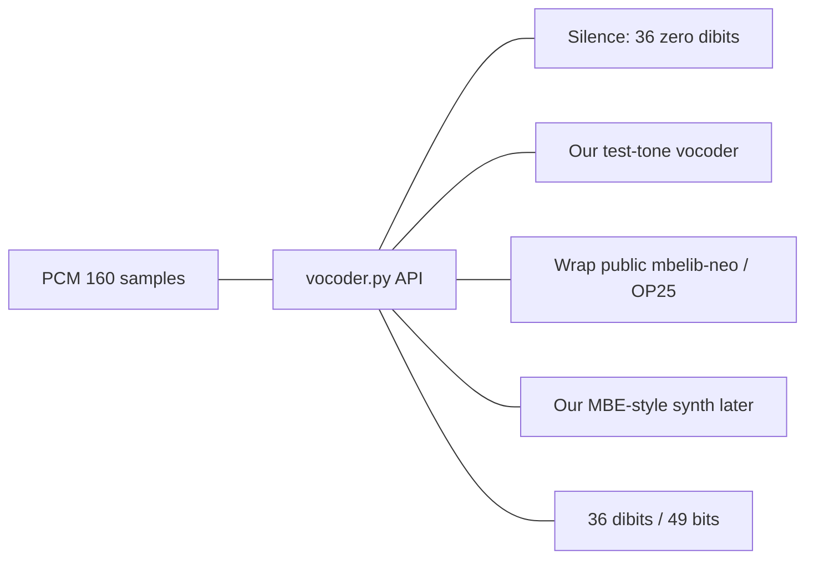
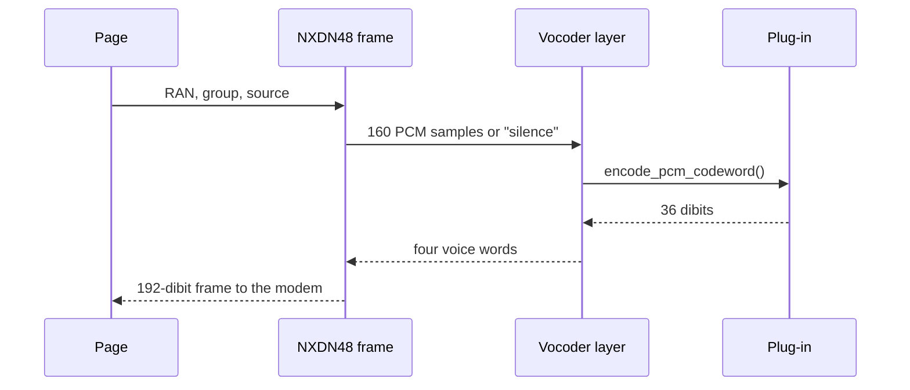
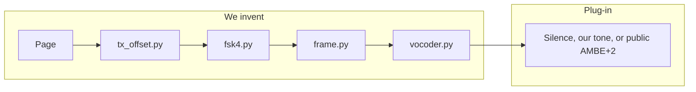
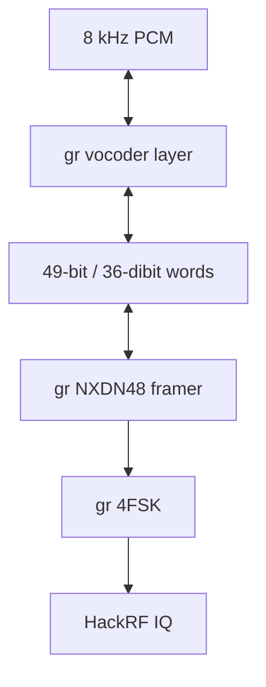

# Roadmap

The goal is a **HackRF One bench radio** you test experimental stacks against. The board, the page, and half-duplex GNU Radio stay. Stacks plug in: P25 Phase 1 and narrowband FM are live; NXDN is next.

This project stays on public code we write or wrap. It does not link DVSI’s closed AMBE SDK, and it does not flash radio firmware.

The vocoder is a **layer we invent**. The air interface (NXDN frames, 4FSK, HackRF) talks to that layer through a small API. Implementations plug into the same slot: silence, a test tone we write, a public AMBE+2 wrap, or a vocoder we design later.

## Vocoder layer

Every 20 ms the radio needs a voice word: PCM in one direction, packed bits in the other. That slot is ours. We choose what sits inside it.

| Plug-in | Who writes it | What a radio hears |
| --- | --- | --- |
| Silence | This repo, now | Sync possible, speaker stays quiet |
| Test-tone vocoder | This repo | A tone we generate in this layer |
| Public AMBE+2 wrap | mbelib-neo / OP25 `ambe_encoder`, we only call it | NXDN/DMR-shaped speech a stock radio can unmute |
| Our own MBE-style vocoder | This repo, later | Our analysis/synthesis in the same 20 ms slot |

The wrap is for a Motorola that expects AMBE+2 on the air. The invented layer is still ours: the frame builder never talks to DVSI, only to `encode_pcm_codeword` / `decode_codeword_pcm`.

P25 Phase 1 already does the same split with IMBE: the page does not run a microphone coder. It puts the TIA 1011 Hz vector in the vocoder slot. NXDN gets the same idea.

## Now

- Keep the HackRF One bench radio: one frequency, half duplex, RF amp off, Receive / Transmit / Stop latched until Stop.
- Finish the P25 stack’s on-air test tone: Transmit must stay running, the 50 kHz tuner offset must land the carrier on the typed frequency, and a second radio must unmute.
- Keep the NBFM stack on C++ UDP (no ALSA). Companion graphs in `grc/` are the portable copy of that stack.

## Later: Raspberry Pi

The analog NBFM graphs are GNU Radio Companion sources in [`grc/`](grc/README.md). A Pi can open `nbfm_rx.grc` / `nbfm_tx.grc`, change `device_args`, and keep the UDP audio path. No ALSA. P25 remains boatbod OP25 on that same box if you install it.

## Next: NXDN around that vocoder layer

Public AMBE+2 decode already exists if we want a stock NXDN radio to unmute. Those libraries are optional plug-ins, not the layer.

| Source | License | What it does |
| --- | --- | --- |
| [szechyjs/mbelib](https://github.com/szechyjs/mbelib) | ISC | Open IMBE/AMBE decoder. Ships a patent notice. |
| [lwvmobile/dsd-fme](https://github.com/lwvmobile/dsd-fme) | GPL | Uses mbelib. Decodes NXDN, DMR, P25 Phase 2. No transmit. |
| [arancormonk/mbelib-neo](https://github.com/arancormonk/mbelib-neo) | ISC | AMBE+2 3600×2450 decode, plus `mbe_encodeAmbe2450Parms`. |
| Osmocom OP25 `ambe_encoder` / `nxdn_tx_sb` | GPL | Software half-rate encoder and NXDN frames. Not in this boatbod tree. |
| [MW0MWZ/OpenDMR](https://github.com/MW0MWZ/OpenDMR) | GPL-2.0 | mbelib-neo decode plus the OP25 encoder. |
| [GopherTrunk ambe2](https://gophertrunk.org/blog/deep-dives/voice-coding-07-ambe-plus-2/) | project license | Pure-Go AMBE+2 decoder from mbelib tables. |

Patents on DVSI’s algorithm can still apply to a compiled AMBE+2 plug-in. A vocoder we invent in our own layer does not have to be that algorithm.

### Code we own today

| Layer | Path |
| --- | --- |
| Page | `app/index.html` |
| HackRF offset | `app/tx_offset.py` |
| NXDN 4FSK map ±350 / ±1050 Hz | `app/nxdn/fsk4.py` |
| NXDN48 FS, LICH, SACCH, RAN | `app/nxdn/frame.py` |
| Vocoder layer API | `app/nxdn/vocoder.py` |
| Dry-run dibit file | `python -m` `app.nxdn.craft` → `local/nxdn.dat` |

`local/nxdn.dat` is 70 frames of silence words. The HackRF is not opened until a dry-run file is the shape of a conventional NXDN48 voice frame.

### GNU Radio blocks

1. **Vocoder layer block** — 160 samples ↔ 36 dibits. First implementation: silence and our test tone. Optional: call mbelib-neo in the same block.
2. **NXDN 4FSK framer** — RAN 0–63, group call, 2400 symbols/s for 6.25 kHz. `app/nxdn/frame.py` is the start of this block.
3. **Page mode switch** — P25 Phase 1 stays default. NXDN conventional is a second mode with frequency, RAN, talkgroup, source ID, and the same Receive / Transmit / Stop latch.

Receive for NXDN can ship first. Transmit waits on a dry-run symbol file, the same gate P25 used.

## Later

- Our own MBE-style analysis/synthesis inside `vocoder.py`, still 20 ms frames.
- DMR and Fusion after NXDN receive works. This OP25 build already lists them in `dv_tx.py`.
- A second-radio check if a stock Phase 1 radio still stays quiet on the P25 stack.
- This bench stays clear-voice and conventional: no Phase 2 TDMA, trunking, encryption keys, or inhibit packets.

## Out of this roadmap

- DVSI AMBE-3000 hardware or their closed SDK.
- Copying a vocoder out of radio firmware.
